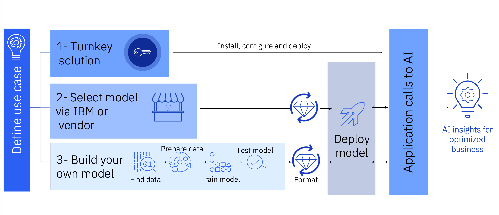

# Use Cases & AI Entry Points

## Overview { #overview }

Organizations adopt AI on IBM Z differently based on their business goals. Some may adopt a pre-built solution, deploy an existing model, or build their own. Understanding these entry points can help you identify the products, skills, and lifecycle stages most relevant to your AI journey.

### The Three AI Entry Points { #ai-entry-points }

While AI implementations vary, many follow a similar path from identifying a business problem to delivering AI-driven outcomes. The three entry points below reflect common approaches organizations take when adopting AI on IBM Z.

- **1 — Turnkey Solution**

    *Install, configure, deploy.*

    IBM and its partners offer pre-built AI solutions that are ready to deploy with minimal setup. These solutions embed AI directly into the platform or provide vendor-managed models that are purpose-built for specific business domains.

    **When to choose this entry point**

    - Your team has limited or no data science expertise
    - You need fast time-to-value with minimal build effort
    - A proven, pre-built solution already exists for your use case
    - You prefer a managed or embedded AI experience

    [Browse Turnkey & ISV Solutions →](../products-tools/turnkey-solutions.md)

- **2 — Select a Model via IBM or Vendor**

    *Leverage an existing model with IBM Z inferencing acceleration.*

    Choose a foundation model, open-source model, or vendor-supplied model and deploy it on IBM Z using IBM's inferencing infrastructure and hardware acceleration. No model training required — focus is on serving and integration.

    **When to choose this entry point**

    - A suitable model already exists (IBM, open source, or vendor)
    - Your team has integration and deployment skills but not model training expertise
    - You want hardware-accelerated inferencing (Telum, Spyre) without building a model from scratch
    - You are deploying a foundation model or LLM for generative AI workloads

- **3 — Build Your Own Model**

    *Full AI lifecycle — from your data to your deployed model.*

    When no existing model meets your needs you can build one. This entry point covers the full lifecycle: find and prepare data, train a model on your enterprise data, test and validate it, optimize it for deployment, and serve it in production on IBM Z.

    **When to choose this entry point**

    - Your use case is highly specific to your business and data
    - You have data science and machine learning expertise in-house
    - Existing models do not provide sufficient accuracy or coverage
    - You need full control over model behavior, training data, and versioning

---

### Which Entry Point Is Right for You? { #which-entry-point }

| If you want to… | Entry Point |
|---|---|
| Adopt AI quickly with no model training or data science team | 1 — Turnkey Solution |
| Deploy a proven IBM, open-source, or vendor model on IBM Z hardware acceleration | 2 — Select a Model |
| Train a model on your own data and own the full AI lifecycle | 3 — Build Your Own |

Once you've identified your entry point, explore the [AI Lifecycle](../prepare-data/lifecycle-overview.md) for implementation guidance, and [Products & Tools](../products-tools/overview.md) for a full catalog of available technologies.

---

## Additional Use Case Resources { #next-steps }

- **[Advanced Credit Card Fraud Detection](use-cases.md)**

    See a full end-to-end solution blueprint — Advanced Credit Card Fraud Detection using an XGBoost and BERT ensemble on IBM z17.

- **[Solution Blueprints](ai-solution-template.md)**

    Explore more AI solution patterns covering generative AI, fraud detection, credit risk, health insurance claims, data preprocessing, and anti-money laundering.

- **[AI Lifecycle](../prepare-data/lifecycle-overview.md)**

    Follow the end-to-end AI lifecycle on IBM Z — from preparing data and training models to deploying, serving, and governing AI in production.

- **[Products & Tools](../products-tools/overview.md)**

    Browse the full catalog of IBM Z AI products and tools across the lifecycle to identify what fits your use case and entry point.

