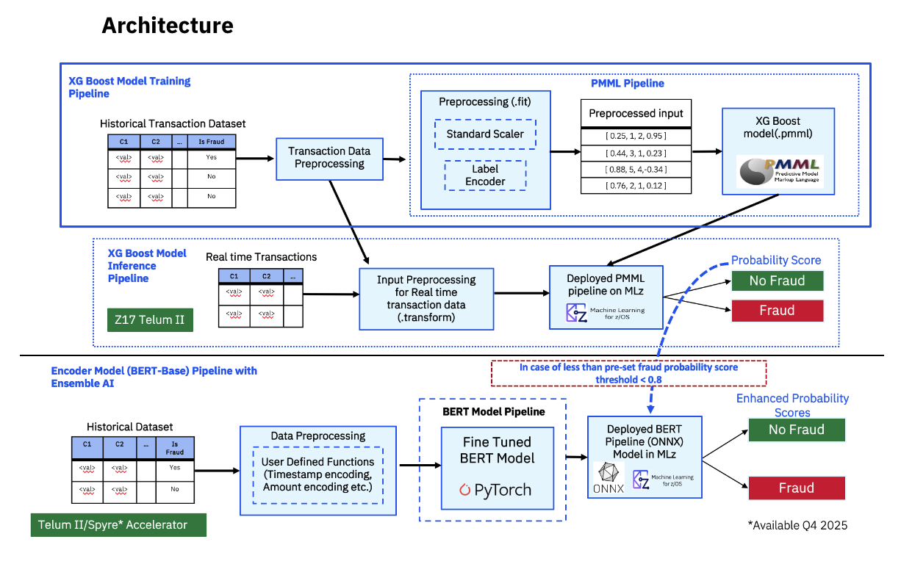

# Advanced Credit Card Fraud Detection { #ai-solution-patterns }

Explore a end-to-end solution blueprint demonstrating how to build, deploy, and evaluate a multi-model ensemble AI system on IBM z17. Review the architecture, key capabilities, model pipelines, and system requirements below.

## Solution Blueprint — Advanced Credit Card Fraud Detection { #fraud-detection-featured }

**Multi-Model Ensemble AI on IBM z17**

[View on GitHub](https://github.com/ambitus/aionz-st-multi-model-credit-card-fraud-detection){ .md-button .md-button--primary } [Book a Workshop →](mailto:aionz@us.ibm.com?subject=Book%20a%20Workshop){ .md-button }

---

Financial institutions need to detect fraudulent transactions quickly and accurately while maintaining the throughput and low latency required for high-volume payment processing. This use case demonstrates an Ensemble AI approach on IBM z17, combining XGBoost and BERT models to enhance credit card fraud detection while optimizing how AI models are applied during transaction processing.

Using IBM Synthetic Data Sets, organizations can train and evaluate models against transactional data such as transaction amount, merchant information, location, time, and transaction type. The solution uses XGBoost as the primary model for analyzing transactions, while the BERT model provides additional analysis when the XGBoost prediction falls below a pre-set probability score threshold. This multi-model approach helps improve prediction results while avoiding the need to run the more advanced model against every transaction.

The trained models are deployed with Machine Learning for IBM z/OS (MLz), where scoring endpoints enable the models to be integrated into an ensemble inference pipeline and enterprise applications. The end-to-end use case covers AI Model Training, AI Model Deployment, and AI Model Analysis, demonstrating how organizations can operationalize multiple AI models on IBM z17 to identify potential fraud and support decisions to approve, flag, or block transactions.

---

**Architecture**
{ .blueprint-subheading }

---

**Key Features**
{ .blueprint-subheading }

This solution brings together an Ensemble AI approach, IBM-optimized hardware, and a complete end-to-end lifecycle in a single runnable template.

- **Ensemble AI —** XGBoost screens every transaction at speed; when its fraud probability falls below the user-set threshold (default 0.8), BERT automatically steps in for enhanced precision
- **IBM Synthetic Data Sets —** realistic labeled credit card transaction data (User, Card, Amount, Use Chip, Merchant, Zip) ready to use from day one
- **Multi-model MLz deployment —** XGBoost exported as PMML and BERT as ONNX, both deployed via Machine Learning for IBM z/OS with CICS or REST scoring endpoints
- **Co-located inference on IBM z17 —** AI runs directly alongside transactional data, accelerated by Telum II / Spyre, reducing offload latency and enabling every transaction to be screened
- **Actionable output —** probability scores let applications approve, flag, or block transactions at the moment they happen
- **Full lifecycle coverage —** data prep → training → evaluation → export → deployment → analysis, with all sample code included

---

## Additional Use Case Resources { #next-steps }

- **[Solution Blueprints](ai-solution-template.md)**

    Explore more AI solution patterns covering generative AI, fraud detection, credit risk, health insurance claims, data preprocessing, and anti-money laundering — all with working code.

- **[Use Cases Overview](overview.md)**

    Understand the three AI entry points — Turnkey Solution, Select a Model, and Build Your Own — to identify the approach that best fits your organization.

- **[AI Lifecycle](../prepare-data/lifecycle-overview.md)**

    Follow the end-to-end AI lifecycle on IBM Z — from preparing data and training models to deploying, serving, and governing AI in production.

- **[Products & Tools](../products-tools/overview.md)**

    Browse the full catalog of IBM Z AI products and tools to identify what fits your use case and entry point.

